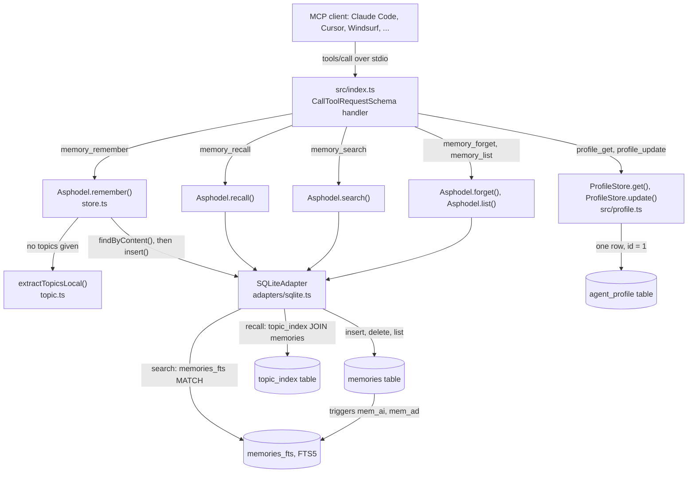
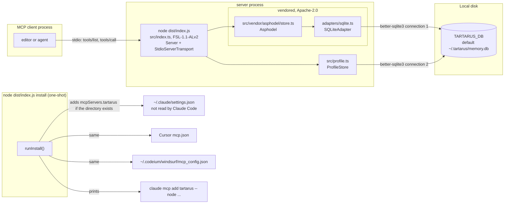
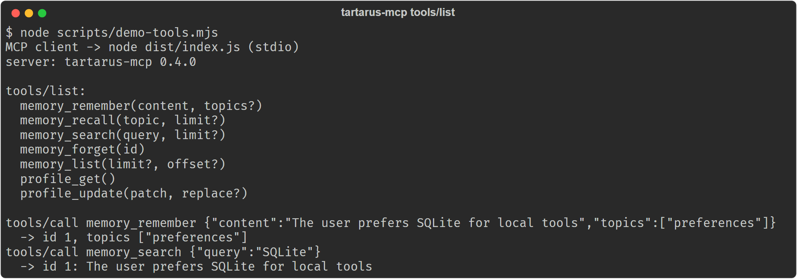

# tartarus-mcp

Local-first MCP memory server. Persistent, searchable memory for any AI agent.

Built on the Apache-2.0 [Asphodel](./src/vendor/asphodel/NOTICE) memory core, vendored in this repo. Zero cloud dependencies. SQLite-backed.

## How it works

One `tools/call` from the client is one handler branch in `src/index.ts`, one method on the vendored core or the profile store, and one SQLite statement against a single local file.



All four tables live in the one file named by `TARTARUS_DB`. Two things the vendored core can do are not reached from any tool: `Asphodel.hybridSearch()` (vector search, rank fusion, decay) is never called, and `SQLiteAdapter` is constructed without `vectorDims`, so no vector table is created. `memory_remember` returns the existing memory, with `isDuplicate: true`, when identical content is already stored.

## Status

Maintained. Version 0.4.0 (`package.json`). The server speaks MCP over stdio and exposes seven tools: five memory tools and two agent-profile tools. CI on Ubuntu and Windows builds it, runs the vendored core tests, and runs a smoke test that starts the real server and calls every tool.

Not published to npm or any other registry; install from source (see [Distribution](#distribution)).

> **Correction, 2026-10-22:** this README said `install` "configures Claude Code". It writes an `mcpServers` entry to `~/.claude/settings.json`, and Claude Code does not read MCP servers from that file: its user-scope servers live in `~/.claude.json` (written by `claude mcp add`) and project servers in `.mcp.json` ([Claude Code MCP docs](https://code.claude.com/docs/en/mcp)). For Claude Code, run the `claude mcp add` line that `install` prints. The Cursor and Windsurf entries are unaffected.

## Install

Tested with Node.js 24 and npm 11 on Windows; CI uses Node.js 22 on Ubuntu and Windows (`engines` says `>=18`).

### Build from source

tartarus-mcp is not published to npm or any other package registry. Build it from this repository, pinned to a reviewed commit:

```bash
git clone https://github.com/saluca-labs/tartarus-mcp.git
cd tartarus-mcp
git checkout d21ea0fc72dd4b1b348ce6f4d6f6090e54ffd152
npm ci --ignore-scripts=false
npm run build
node dist/index.js install
```

`install` writes an MCP entry for Cursor and Windsurf (and for Claude Code at `~/.claude/settings.json`, which Claude Code does not read; see the correction above) that runs `node /absolute/path/to/tartarus-mcp/dist/index.js`, so keep the checkout where it is. It also prints the equivalent `claude mcp add` line for the Claude Code CLI; use that line for Claude Code.

`--ignore-scripts=false` is needed only if your npm config sets `ignore-scripts=true`: the `better-sqlite3` dependency compiles or downloads its native binding in an install script.

### Manual setup

After building, add this to your MCP settings, using the absolute path of your checkout:

```json
{
  "mcpServers": {
    "tartarus": {
      "command": "node",
      "args": ["/absolute/path/to/tartarus-mcp/dist/index.js"]
    }
  }
}
```

### Without a local checkout

npm can fetch and build the pinned commit straight from GitHub. This does not use the npm registry for tartarus-mcp itself; its third-party dependencies still come from npm.

```json
{
  "mcpServers": {
    "tartarus": {
      "command": "npx",
      "args": ["-y", "--ignore-scripts=false", "github:saluca-labs/tartarus-mcp#d21ea0fc72dd4b1b348ce6f4d6f6090e54ffd152"]
    }
  }
}
```

The first start takes about 30 seconds while it builds. Pin a full commit SHA, never a branch.

## Agent quickstart

For an agent setting this up, after the build above. Replace `/absolute/path/to/tartarus-mcp` with the checkout's absolute path; `install` prints this exact line with the path filled in.

Claude Code (user or project scope is set with `claude mcp add --scope`):

```bash
claude mcp add tartarus -- node "/absolute/path/to/tartarus-mcp/dist/index.js"
```

With a non-default database file, pass `TARTARUS_DB` through Claude Code's `-e` option:

```bash
claude mcp add tartarus -e TARTARUS_DB=/path/to/memory.db -- node "/absolute/path/to/tartarus-mcp/dist/index.js"
```

Any client that reads an `mcpServers` block (Cursor's `mcp.json`, Windsurf's `mcp_config.json`, a project `.mcp.json`):

```json
{
  "mcpServers": {
    "tartarus": {
      "command": "node",
      "args": ["/absolute/path/to/tartarus-mcp/dist/index.js"],
      "env": { "TARTARUS_DB": "/path/to/memory.db" }
    }
  }
}
```

`env` is optional; without it the database is `~/.tartarus/memory.db`. Once connected, call `profile_get` at the start of a session and `memory_search` before asking the user something they may already have said. The seven tool names in [Usage](#usage) are the whole surface: there are no resources or prompts.

## Quickstart

After `npm run build`, `scripts/demo-tools.mjs` starts the built server over stdio the way an editor does, against a throwaway database, lists its tools and makes one store-and-search round trip:

```bash
node scripts/demo-tools.mjs
```

Output from a run on 2026-10-22:

```text
MCP client -> node dist/index.js (stdio)
server: tartarus-mcp 0.4.0

tools/list:
  memory_remember(content, topics?)
  memory_recall(topic, limit?)
  memory_search(query, limit?)
  memory_forget(id)
  memory_list(limit?, offset?)
  profile_get()
  profile_update(patch, replace?)

tools/call memory_remember {"content":"The user prefers SQLite for local tools","topics":["preferences"]}
  -> id 1, topics ["preferences"]
tools/call memory_search {"query":"SQLite"}
  -> id 1: The user prefers SQLite for local tools
```

`npm run smoke` runs the longer check CI uses: every tool, including profile merges and forget.

## Usage

### Tools

| Tool | Description |
|------|-------------|
| `memory_remember` | Store a memory (topics auto-extracted) |
| `memory_recall` | Retrieve memories by topic |
| `memory_search` | Full-text search across all memories |
| `memory_forget` | Delete a memory by ID |
| `memory_list` | List recent memories |
| `profile_get` | Read the agent profile (empty `{}` on a fresh install) |
| `profile_update` | Merge changes into the agent profile |

### Agent profile

Memory answers *what happened*. The profile answers *who am I working with, and how do we work* -
the standing facts an agent would otherwise re-derive every session, or re-ask about.

It **starts empty** and the agent fills it in over time:

```jsonc
// profile_get on a fresh install
{ "profile": {}, "updated_at": null, "revision": 0 }

// profile_update { "patch": { "user": { "name": "Ada" }, "tone": "terse" } }
{ "profile": { "user": { "name": "Ada" }, "tone": "terse" }, "revision": 1, ... }

// profile_update { "patch": { "user": { "role": "engineer" }, "tone": null } }
{ "profile": { "user": { "name": "Ada", "role": "engineer" } }, "revision": 2, ... }
```

**Merge semantics**, because this is the part that is easy to get wrong:

- objects merge **recursively**, so setting one field keeps its siblings
- `null` **deletes** a key - the only way to remove one
- arrays **replace** wholesale; positional merging of lists is never what a caller means
- `"replace": true` swaps the whole document, for a deliberate reset

**What goes where.** Durable facts about the person, the project or the working agreement belong
in the profile. Things that *happened* belong in `memory_remember`. The distinction matters
because memories decay and compete for recall, while the profile is one small document meant to
be read in full at the start of a session.

The profile lives in its own table in the same SQLite file, so `memory_forget` cannot delete part
of an identity by id and decay cannot quietly age out a working agreement.

### Config

```bash
TARTARUS_DB=/path/to/memory.db  # default: ~/.tartarus/memory.db
```

## Architecture

Two processes and one file. The server process is the only writer; `install` is a separate one-shot run of the same entry point that edits editor config files and exits.



- `src/index.ts`: the `install` command, the tool definitions and the MCP request handlers.
- `src/vendor/asphodel/`: the vendored memory core (`Asphodel`, `SQLiteAdapter`, topic extraction, full-text search through SQLite FTS5). Its `NOTICE` lists which files were changed from upstream.
- `src/profile.ts`: the agent profile, one JSON document in its own table of the same database.
- `scripts/`: `check-package-meta.mjs` (licence, notices and README pin), `smoke-mcp.mjs` and `smoke-install.mjs` (runtime checks used by CI), `demo-tools.mjs` (the quickstart above).

Limits fixed in the code, not configurable from a tool call: `memory_recall` and `memory_search` default to 10 results and `memory_list` to 20 (`store.ts`, `src/index.ts`); a memory keeps at most 10 topics (`store.ts`, `DEFAULT_MAX_TOPICS`); and each topic word indexes at most the 10 newest memories, so `memory_recall` on a busy topic drops the oldest from that topic while `memory_search` still finds them (`adapters/sqlite.ts`, `maxMemoriesPerTopic`).

### In this repo and not in this repo

| Layer | In this repo | Licence | Where it lives |
|---|---|---|---|
| MCP server, `install` command, agent profile | yes | FSL-1.1-ALv2 | `src/index.ts`, `src/profile.ts` |
| Asphodel memory core (0.4.0 line) | yes, vendored | Apache-2.0 | `src/vendor/asphodel/`, origin commit in its `NOTICE` |
| Earlier Asphodel library line (`@saluca/asphodel` 0.3.0) | no | see that repo | [saluca-labs/elysium](https://github.com/saluca-labs/elysium) |
| Hash-chained audit, multi-tenant isolation, team memory | no | not open source | [asphodel.ai](https://asphodel.ai) |

## Screenshots



Captured 2026-10-22 from a clean clone by running `node scripts/demo-tools.mjs`; the exact text is in [docs/img/tools-list-2026-10-22.txt](docs/img/tools-list-2026-10-22.txt).

## Citation

No archived record yet.

## License

Functional Source License 1.1, Apache 2.0 Future License (`FSL-1.1-ALv2`), see [LICENSE](./LICENSE). Each version becomes available under the Apache License 2.0 on the second anniversary of its release. Copyright [Saluca LLC](https://saluca.com).

The vendored Asphodel core in [`src/vendor/asphodel/`](./src/vendor/asphodel/) (and its tests in `tests/vendor/asphodel/`) is licensed under the Apache License 2.0, not FSL; see its [LICENSE](./src/vendor/asphodel/LICENSE) and [NOTICE](./src/vendor/asphodel/NOTICE), which record the origin commit.

Versions 0.2.0 and earlier were published to npm with an `Apache-2.0` licence field, and those releases remain available under Apache 2.0.

GitHub shows this repository's licence as "Other" because its licence detector does not include the FSL; the SPDX identifier is `FSL-1.1-ALv2`.

## Distribution

npm is no longer a distribution channel. On 2026-09-16 Saluca removed all of its packages from npm, including `tartarus-mcp` and `@saluca/asphodel`, which tartarus-mcp used to depend on. That is why the Asphodel core is vendored here, why `package.json` is `"private": true`, and why the npm publish workflow was removed. Install from source as described above. Do not install a package named `tartarus-mcp` from npm: it is not ours.

## Links

- [Model Context Protocol](https://modelcontextprotocol.io)
- [elysium](https://github.com/saluca-labs/elysium): an earlier line of the Asphodel memory library (`@saluca/asphodel` 0.3.0, not the 0.4.0 vendored here)
- Enterprise: hash-chained audit trails, multi-tenant isolation, compliance controls, and team memory at [asphodel.ai](https://asphodel.ai)
- [llms.txt](./llms.txt): a link map of this repo for AI agents

_Last updated: 2026-10-22_
